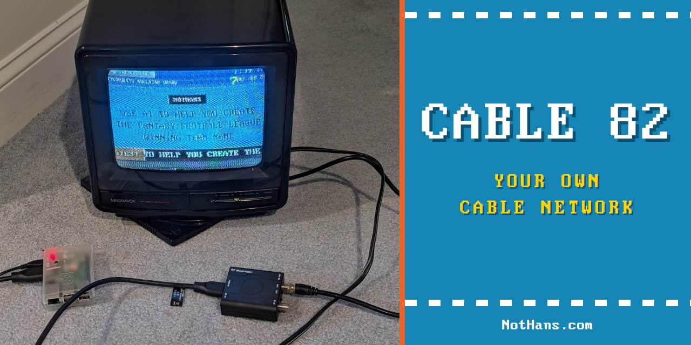
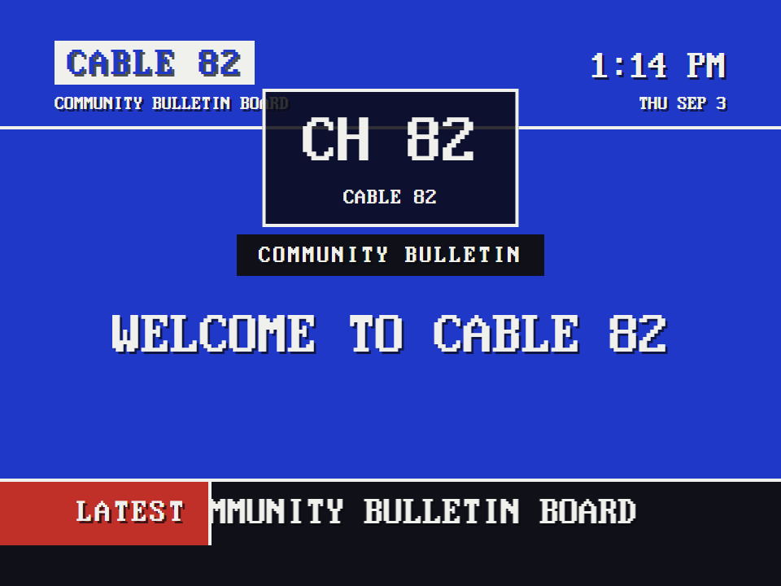
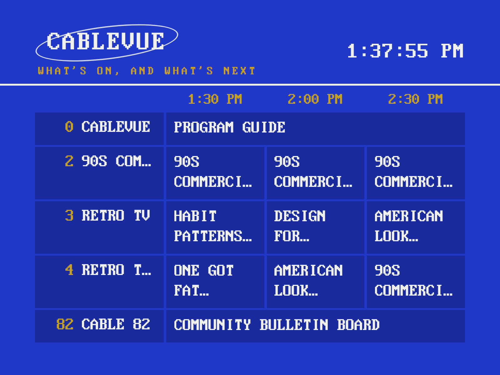
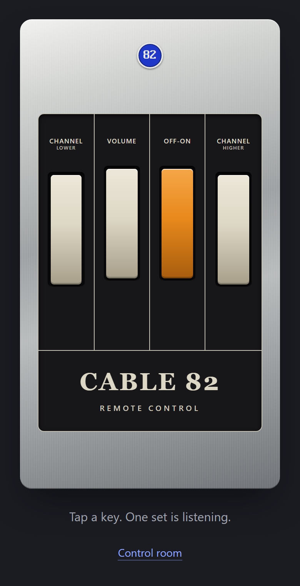

# CABLE 82

Your own cable network. You set the programming.



[](https://github.com/nothans/cable-82/releases)
[](https://nodejs.org/)
[](LICENSE)

CABLE 82 runs a dial of TV channels in one browser, from one Node.js server with no dependencies.
It plays on a laptop, a flat panel, or a Raspberry Pi feeding a 1987 television on channel 3.

## Quick start

You need Node.js 18 or newer.

```bash
git clone https://github.com/nothans/cable-82
cd cable-82
node server.js
```

The server prints the addresses it answers on:

```text
CABLE 82 broadcasting
  http://localhost:1982   (a browser on this machine)
  http://192.168.1.42:1982   (a browser on another device on your network)
Control room: http://localhost:1982/config
Remote control: http://192.168.1.42:1982/remote-control   (open it on your phone)
```

Open the first address to tune in: the Community Bulletin Board is on channel 82, and CABLEVUE, the guide, is on channel 0.
The up arrow turns the dial.



## Example: a channel of old films

`fetch-demo-channel.js` downloads eight public-domain films from the Internet Archive's Prelinger collection into `channels/retro-tv/`:

```bash
node channels/fetch-demo-channel.js
```

```text
RETRO TV: fetching 8 public-domain films into .../cable-82/channels/retro-tv
...
8 films on the shelf.
Now open the control room (/config), add a Video channel, and pick the retro-tv folder.
```

Add the channel in the control room and it plays on a broadcast clock.
Tune away and back, and the film has kept running.
The guide lists it with the other channels, now and next, half hour by half hour.



## Features

- Channel 82, the Community Bulletin Board: your messages, the time, facts, dad jokes, the weather, RSS headlines in a crawl, the CheerLights color, and music behind it.
- Video channels from a folder of files, on a local disk, a USB drive, or a network share, with scheduled hours and commercial breaks.
- CABLEVUE, a guide on channel 0 that reads the same clock as the player, so it matches what is on.
- Jarvis, a 1980s computer-generated host who cuts in over any channel to say a line or answer a question, through `POST /api/jarvis`.
- Tuning from the keyboard, a USB gamepad or joystick, the phone remote at `/remote-control`, or `POST /api/tune`.
- The control room at `/config`: every setting on one page with one Save, picked up by the set at once.
- Output made for CRTs (4:3, per-axis overscan, a broadcast-safe palette) and a drawn faux CRT console for flat panels.
- Any web page as a channel, such as [ws4kp](https://github.com/netbymatt/ws4kp) for weather.

| Jarvis | The control room | The remote |
| :---: | :---: | :---: |
|  |  |  |

## On a real television

The reference build is a Raspberry Pi 3 Model B+ on Raspberry Pi OS (64-bit) Trixie, an HDMI-to-RF modulator, and a 1987 Magnavox portable on channel 3.
The [Raspberry Pi guide](docs/raspberry-pi.md) covers Node.js on the Pi, power, the systemd service, the Chromium kiosk, RF and composite output, and tuning the picture.


## Limits

- The API has no authentication.
  Anyone on your network can change the channel, save settings, or restart a Pi.
  Do not expose it to the internet.
- Video channels need a Pi 3 B+ or newer, which decodes H.264 up to about 480p comfortably.
  A Pi 2 runs the bulletin board only.
  A Pi Zero or Pi 1 can be the server but not the TV.
- Browsers hold back sound until the first click.
  The Pi kiosk launch line turns that off.
- The phone remote installs as a full-screen app on an iPhone.
  Android makes a browser shortcut instead, because the station serves plain HTTP.

## Documentation

- [The control room](docs/control-room.md): the six groups, saving, and the Vitals panel.
- [Channels](docs/channels.md): channel types, schedules, commercial breaks, drives, tuning, and switching off.
- [The Community Bulletin Board](docs/community-board.md): pages, music, CheerLights, and feeds.
- [Jarvis](docs/jarvis.md): the host, his voice, and [callers from the shell, Python, Node, and Home Assistant](examples/jarvis).
- [Raspberry Pi and a CRT](docs/raspberry-pi.md): the full build, step by step, and [updating](docs/updating.md).
- [Troubleshooting](docs/troubleshooting.md): error messages, addresses, sound, and the first ten minutes.
- [API](docs/api.md) and [configuration](docs/config.md) references.
- The [build story](https://nothans.com/cable-82-turn-a-raspberry-pi-and-an-old-crt-into-a-1982-cable-bulletin-board-channel), the [build tutorial](https://nothans.com/cable-82-tv-channel-build-tutorial-rasbperry-pi-3-b-and-old-crt-tv), and the [explainer video](https://www.youtube.com/watch?v=KROAE0mn7vo).

## Development

There is no build step: the files are what the browser runs.
`node --test test/server.test.mjs test/dial.test.mjs` runs the Node suites.
[Testing](docs/testing.md) covers the browser harness and the end-to-end drill.
[Architecture](docs/architecture.md) maps the files.

## License

The code is under the MIT license ([LICENSE](LICENSE)).
The bundled typeface is the IBM VGA 8x16 face from VileR's [Ultimate Oldschool PC Font Pack](https://int10h.org/oldschool-pc-fonts/), CC BY-SA 4.0 (`fonts/LICENSE.txt`).
Weather data is from [Open-Meteo](https://open-meteo.com/), CC BY 4.0.
