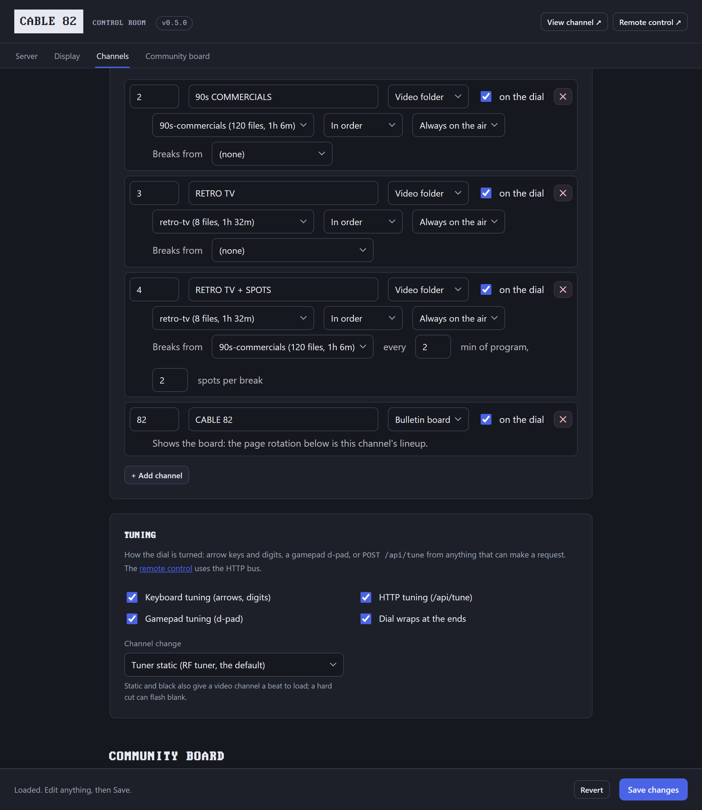
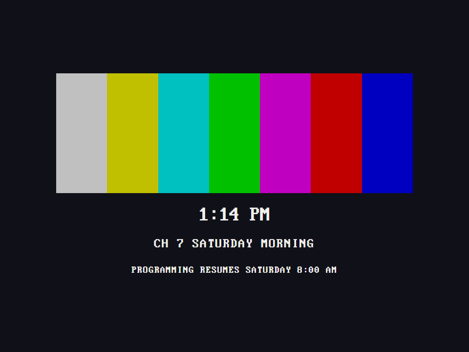
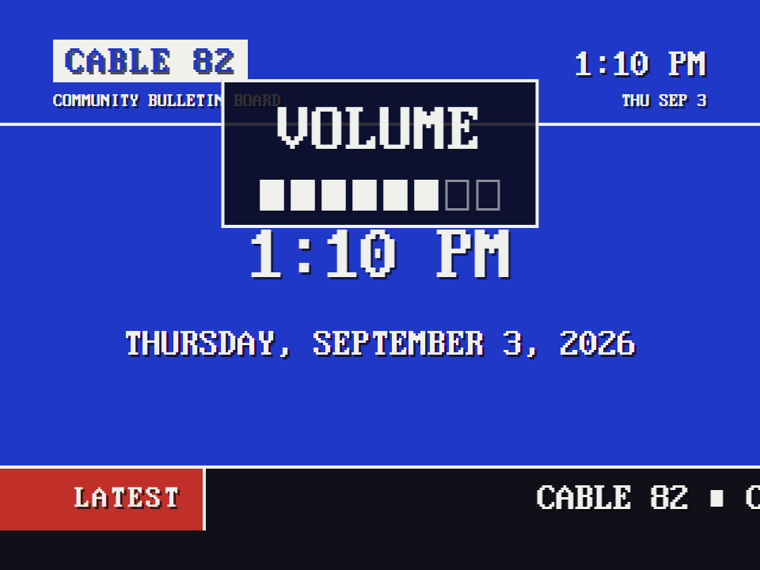

# Channels

A dial of channels you flip through with a keyboard, a USB gamepad or joystick, the remote, or an HTTP call, all inside the one browser that is already on the air.
The control room's Channels group is where you build it: add a channel, give it a number and a name, pick its type, and it is on the dial.

Four kinds of channel:

- **Bulletin** - the bundled [Community Bulletin Board](community-board.md). Its lineup is the page rotation.
- **Video** - a folder of video files under [`channels/`](../channels/README.md), played in order on a *broadcast clock*: the channel's position is computed from the wall clock, so tuning away and back lands you mid-program, like real TV. Play in filename order or shuffled fresh each day. No videos of your own yet? `node channels/fetch-demo-channel.js` downloads **RETRO TV** - eight public-domain films from the Internet Archive's Prelinger collection (Duck and Cover, Design for Dreaming, One Got Fat...) - and you have a channel.
- **Guide** - **CABLEVUE** on channel 0, the preview channel: a grid of what is on every channel now and next. It reads the same dial and the same broadcast clock the tuner runs on, so it cannot disagree with the picture. A program running long spans its columns, a commercial break is never listed (the guide names the program it sits inside), and the lineup crawls when it is taller than the screen. Its name, tagline, grid, and background live in the control room's **Channel Preview** group, and it follows the same CRT settings the rest of the set does.
- **External** - any URL in a frame; point one at [ws4kp](https://github.com/netbymatt/ws4kp) for a weather channel.

What the guide calls a video channel's programs is the channel's choice, on its row in the dial: the file names (cleaned up: `02 Design for Dreaming (1956).mp4` reads DESIGN FOR DREAMING (1956)), the titles written inside the files (what ffmpeg, HandBrake, or iTunes put there; read once and cached beside the videos), or one fixed name for the whole channel, so a folder of commercials says COMMERCIALS whatever the files are called.

A video channel can run around the clock or keep **scheduled hours** - dayparts like Saturday and Sunday 8:00 to 11:30.
A window whose end time is at or before its start runs overnight into the next morning, so "Saturday 20:00 to 01:00" is one window, not two.
Off the air it shows a test card with the resume time, color bars, or static - or falls back to the board.
The control room draws the week as a grid so you can see the schedule at a glance.

A video channel can also take **commercial breaks**: pick a second folder for the spots, say how many minutes of program run between breaks, and how many spots fill each one.
Each program is cut into even acts of about that length, a break follows every act, the last one included, so a break also separates each program from the next.
The spots cycle through their folder in order (shuffled daily if the channel is), and the movie picks up where the break cut in.
The breaks live on the broadcast clock like everything else, so tune in mid-break and you get the spot in progress.
Set the minutes to 0 for breaks only between programs.

## Channels on another drive

A library does not have to fit on the card the system boots from.
Put a `channels` folder at the top of a USB drive, a spinning disk, or a mounted network share, drop your folders inside it, and they appear in the picker alongside the built-in ones.
The drive is found wherever the machine mounts it (`/media`, `/mnt`, `/Volumes`), and `node server.js --media /path/to/library` names one that lives anywhere else, a network share included.
On a Pi running the service, that flag goes on the unit's `ExecStart` line (see [Run the server on boot](raspberry-pi.md#2-run-the-server-on-boot)).

A drive only counts if it carries a `channels` folder, so plugging in a disk full of photos and tax returns does not offer them as channels.
Folder names stay plain names, so a channel is written the same way wherever its files live, and if the same name exists in two places the built-in folder wins.
The control room says which drive a folder came from, because the same name can mean a different library once the drive is unplugged.
Pull the drive and its channels go off the air with a test card, the same as a folder you deleted; plug it back in and they return.

## Tuning

- **Keyboard** - arrows or PageUp/PageDown to change channel, digits plus Enter to jump straight to a number.
- **Gamepad or joystick** - a USB NES-style controller or a one-button joystick. Up and down change the channel, left and right turn the volume down and up (hold and it keeps going), Select jumps home to the board. Any other button pressed twice switches the set off like the power key, and twice again brings it back. Pressed ten times, it shuts the machine itself down, with a count on the screen from the third press (ten is a setting, **Presses to shut down** in the control room). That way a Pi can be shut down before it is unplugged, without a keyboard or a phone.
- **Remote control** - open `/remote-control` on a phone. It is a page of the board in your hand: four keys, channel up, channel down, volume, power, and the crawl band telling you whether a set is listening. The volume key steps loud, sound off, soft, medium, back to loud, like a 1960s motorized control. Power darkens the set the way a tube goes dark, and the broadcast clock keeps running, so on comes back to the program already in progress. The set remembers its volume and power state across a reload. Put it on the home screen and it opens like an app, with the 82 as its icon: on an iPhone, Share, then Add to Home Screen; on Android, the browser menu's Add to Home screen, or the INSTALL key in the crawl band when the browser offers it. (Browsers only install a web app from a secure origin, and the station serves plain HTTP on your network, so Android makes a shortcut that opens in the browser; the iPhone version is the full-screen one.)
- **HTTP** - `POST /api/tune` with `{"cmd":"up"}`, `{"cmd":"down"}`, `{"cmd":"set","channel":2}`, `{"cmd":"volume"}`, `{"cmd":"volumeUp"}`, `{"cmd":"volumeDown"}`, or `{"cmd":"power"}`. GPIO buttons, a Stream Deck, or anything that can make a request becomes a remote control. The whole bus is in [the API reference](api.md#the-tuner-bus).

Every tune shows the channel on the on-screen display, a plate centered in the upper part of the picture with a dark backing, so it reads over a bright program, a white web page, and the board's own masthead alike.
The volume key draws the level there as a meter of eight cells, empty at sound off, so it can be read across a room.
Channel changes cover the cut with a beat of tuner static, exactly like a rented cable box; if the box you grew up with went black between channels instead, set `tuner.cut` to `black` in the control room (`none` is a hard cut).

The tune API is meant for your LAN and is deliberately unauthenticated - anyone on your network can change the channel, which is also how a living room works.
Do not expose it to the internet.

## Switching off

Press off and the picture does what a tube does when it loses power.
The vertical deflection dies first, so the whole picture folds into one bright line across the middle while the beam is still sweeping side to side.
Then the high voltage drops, the line pulls in to a dot, and the phosphor keeps glowing for a moment after the beam has gone.
On is the same in reverse and quicker: a dot, a line, and the picture blooms open.
Set `tuner.power` to `black` in the control room if you want a flat panel instead, gone the moment you press it.
