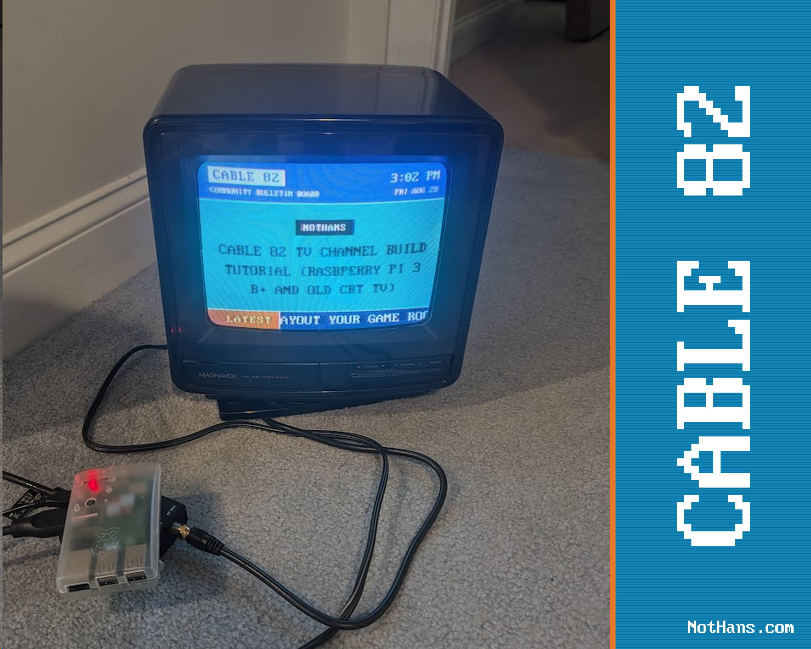
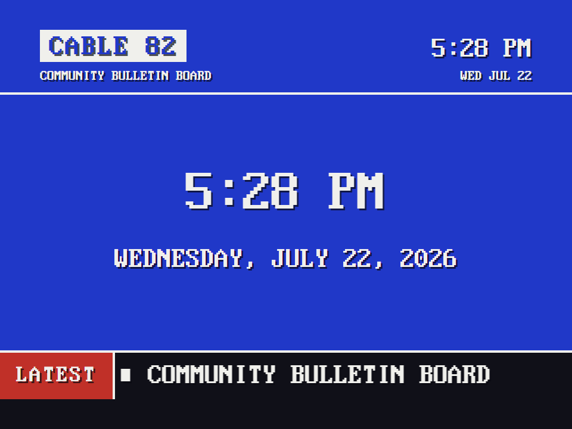
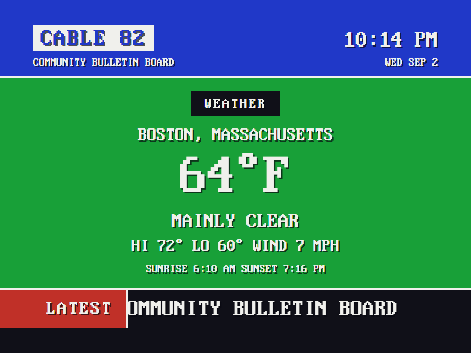
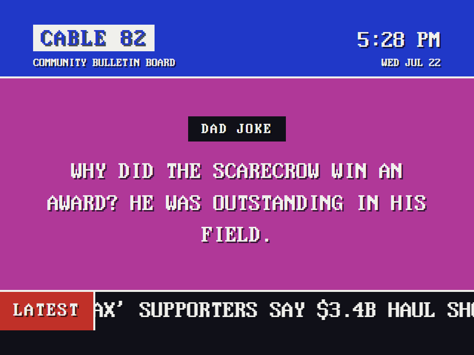
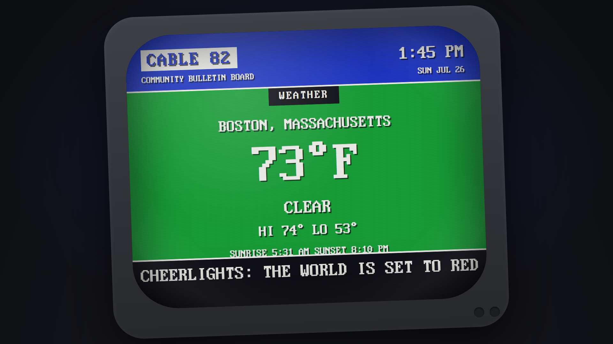

# Channel 82: the Community Bulletin Board

Every cable system had one, somewhere on the dial: the community channel. This is channel 82.



1. **Header band** - station name and the live time and date, always visible.
2. **Pages** - full-screen colored pages that hard-cut every 12 seconds: a big clock, your community messages, DID YOU KNOW facts, DAD JOKE groaners, a WEATHER card, and headlines.
3. **The crawl** - a continuous ticker of headlines along the bottom, fed by RSS.

The WEATHER card is fed by Open-Meteo (free, no account): current conditions, hi/lo, wind, and sunrise/sunset for a location you pick in the control room, in the units you pick there.
(For a full weather *channel*, put [ws4kp](https://github.com/netbymatt/ws4kp) on the dial as an external channel.)

| The time | The weather | A dad joke |
| :---: | :---: | :---: |
|  |  |  |

## Channel 82 Background Music

Add audio files into the [`music/`](../music/) folder and the Community Board plays them as a continuous background bed behind its pages, looping the whole set (shuffle optional).

Browsers block autoplay until a user gesture, so on a desktop the music starts on your first click; on the Pi kiosk the `--autoplay-policy=no-user-gesture-required` flag in the [kiosk launch line](raspberry-pi.md#3-chromium-in-kiosk-mode) starts it from boot.

## CheerLights

The crawl carries one extra item: the latest [CheerLights](https://cheerlights.com) color.
CheerLights is a single global color that anyone in the world can set, and every connected light on the planet follows along.
CABLE 82 checks it about once a minute (server-side, like every other fetch) and scrolls your message with the color name filled in: `THE WORLD IS SET TO {COLOR}` comes out as `THE WORLD IS SET TO PURPLE`.



Turn it off, or make the message yours, in the control room - or in `config.json`:

```json
"cheerlights": {
  "enabled": true,
  "template": "THE WORLD IS SET TO {COLOR}"
}
```

## Feeds and the network

Feeds are fetched by the server, never by the browser, and only URLs listed in `config.json` can be fetched at all.
If a feed goes down, the channel keeps running on the last good copy.
If the network dies entirely, the clock, messages, and facts keep going forever.
