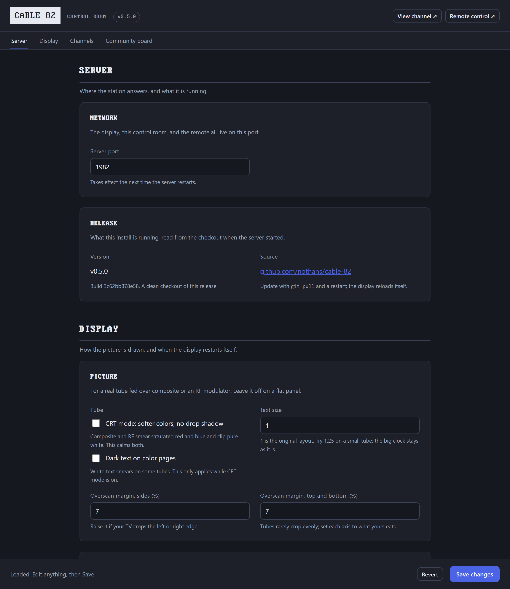
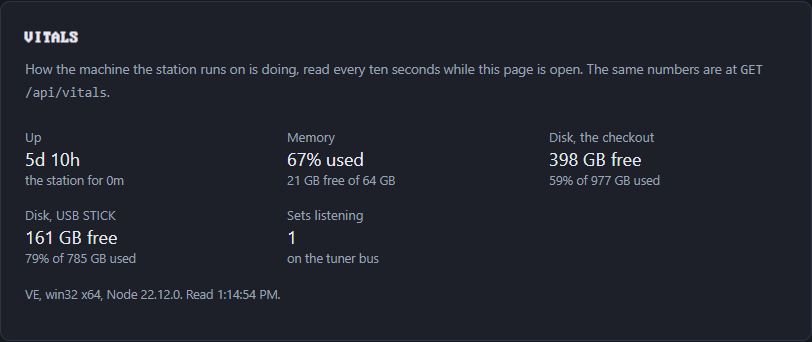

# The control room

Open `http://localhost:1982/config` and the whole network is on one screen, in six groups:

1. **Quick settings** - what a station touches week to week: the station's name and tagline, the community messages, and the music.
2. **Channels** - the dial and its schedules, and how the dial is turned.
3. **Community Board** - the rest of channel 82: the page rotation, colors, facts and jokes, weather, feeds, the crawl, CheerLights.
4. **Channel Preview** - channel 0: the guide's name and tagline, the grid, and its color.
5. **Display** - the set: CRT mode, text size, overscan, faux CRT for a flat panel, clock format, and the daily reload that keeps a kiosk healthy.
6. **Server** - the machine's vitals, the port, restart and shut down on a Pi, and the release you are running.

The bar under the masthead jumps between the groups and follows you as you scroll; `#quick`, `#channels`, `#board`, `#preview`, `#display`, and `#server` are links you can bookmark.
It is one page with one Save, so a change anywhere goes out in the same click: the server tells every display at once and the set reloads itself onto the new settings, on the same channel.
The masthead carries the release you are running, linked to its notes, and links to the display and the remote.

Every change is validated on the server, written to `config.json`, and picked up on air.
If `config.json` changes while a control room is open (a hand edit, or a save from another tab), the open screen warns you, and a stale Save is refused instead of overwriting the newer file.
If a hand edit leaves the file unreadable, the last good settings stay on the air, the control room names the line that broke, and a Save writes a good file over it.
Every key is documented in the [configuration reference](config.md).

The Server group's **Vitals** panel shows how the machine is doing, refreshed every ten seconds: uptime, load, memory and swap, the CPU's temperature, the Pi's power flags (under-voltage is the sign of a phone charger standing in for a supply), and the free space on the card and on every drive that carries channels.

