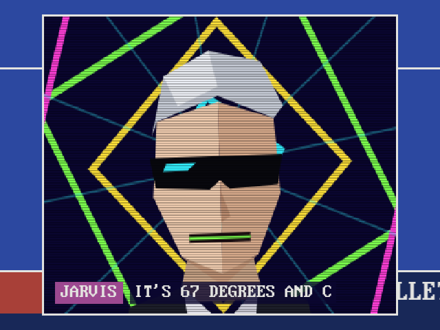

# Jarvis, the on-screen host

Jarvis is the station's host.
Send him a line or a question and he cuts in over whatever is on.
He is a low-poly head in shades on a backdrop of turning neon, jerking between poses and tearing like a weak signal, with his line typing out underneath.
His mouth is an oscilloscope trace of his own voice, so it moves with every word.
The channel's sound steps down while he talks, and when he is done he rolls back out.



```bash
curl -X POST http://cable82.local:1982/api/jarvis -d '{"text":"Good evening, and welcome to CABLE 82."}'
curl -X POST http://cable82.local:1982/api/jarvis -d '{"ask":"weather"}'
```

He answers `weather`, `cheerlights`, `time`, and `joke` from what the station already knows, and reads out whatever you send him as `text`.
His voice is [espeak-ng](https://github.com/espeak-ng/espeak-ng): `sudo apt install espeak-ng` on a Pi.
Without it he still appears and talks with a drawn mouth.
His name, his voice, its speed and pitch, and a box to try him live are in the control room's **Jarvis** group.
The whole API is in [docs/api.md](api.md#jarvis), and [examples/jarvis](../examples/jarvis) has him called from the shell, Python, Node, and Home Assistant.
