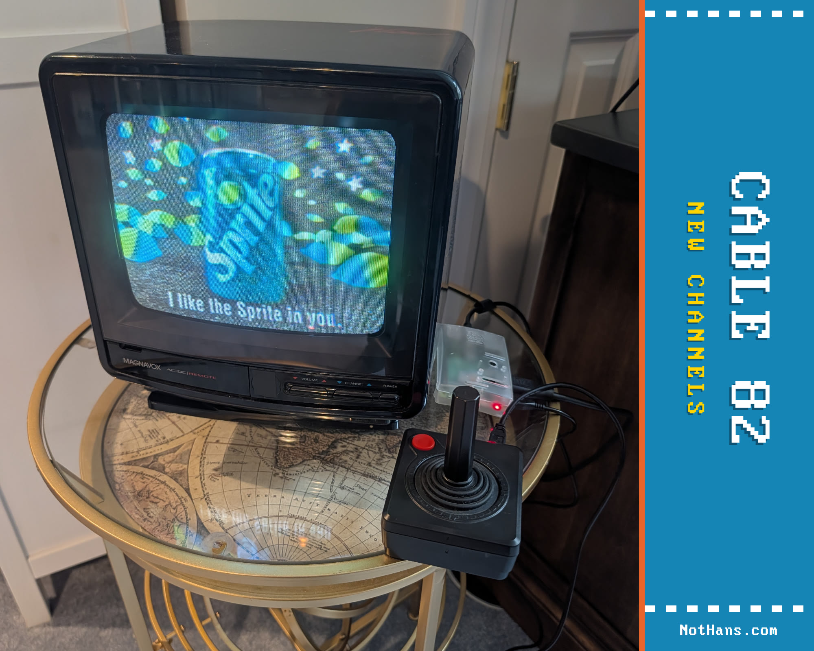

# Running CABLE 82 on a real CRT (Raspberry Pi)

Everything below was run end to end on a Raspberry Pi 3 Model B+ with Raspberry Pi OS (64-bit) "Trixie" and a 1987 Magnavox portable over an HDMI-to-RF modulator on channel 3; the [build tutorial](https://nothans.com/cable-82-tv-channel-build-tutorial-rasbperry-pi-3-b-and-old-crt-tv) walks the same ground with photos.



## Node.js on a Raspberry Pi

Raspberry Pi OS does not ship with Node.js, and the version its own `apt` offers depends on the OS release: Bookworm (2023) and Trixie (2025) give Node 18 or 20, which work; Bullseye (2021) and older give Node 12, which does not.
The sure way on a 64-bit image, any Pi from the 3 onward:

```
curl -fsSL https://deb.nodesource.com/setup_22.x | sudo -E bash -
sudo apt-get install -y nodejs
node -v
```

`node -v` should now print `v22`.
NodeSource builds for 64-bit only these days; on a 32-bit image use `sudo apt install nodejs` and take the distro's Node 20.
A Pi 1, Pi Zero, or Zero W is ARMv6: Node 20 installs from `apt` and the server runs, but no current browser runs on that chip (Chromium refuses it outright), so it can be the server and never the TV.
A Pi 2 runs the bulletin board; video channels want a Pi 3 B+ or newer (H.264 up to ~480p decodes comfortably in software there; measured on the 3 B+).

Then clone and start it exactly as in Quick start, and read the addresses it prints.

## 1. Power it properly

A Pi 3 wants a 5V 2.5A supply and a short, thick micro-USB cable; a phone charger will boot it and then quietly run it at less than half speed.
Check:

```
vcgencmd get_throttled
```

`throttled=0x0` is the answer you want.
Anything else is a complaint: `0xd0005` means under-voltage and throttling right now (and that both have happened since boot), and `vcgencmd measure_clock arm` will show a 1.4GHz Pi idling at 600MHz.
(`0x80008` on a 3 B+ is its own soft temperature limit at 60C, normal with Chromium running, and not a power problem.)
The control room's Vitals panel shows the same flags decoded, so you can check from the couch.

## 2. Run the server on boot

`/etc/systemd/system/cable82.service`:

```
[Unit]
Description=CABLE 82
After=network-online.target

[Service]
ExecStart=/usr/bin/node /home/pi/cable-82/server.js
Restart=always
User=pi

[Install]
WantedBy=multi-user.target
```

Replace `pi` (both places) with your own username if it differs: `whoami` tells you, and newer Raspberry Pi OS images let you pick any name at setup.
`which node` confirms the path on the `ExecStart` line.
A library on a network share goes on that line too: `ExecStart=/usr/bin/node /home/pi/cable-82/server.js --media /mnt/library`.
A USB drive needs nothing; it is found where the desktop mounts it.
Then `sudo systemctl enable --now cable82`, and `systemctl status cable82` should say `active (running)` with the broadcasting lines in its log.
When a new release comes out, see [Updating](updating.md): one line, and the TV takes care of itself.

Once the service is running, the control room's **Server** group grows a **Power** panel with Restart and Shut down.
Both flush the disks and hand over to systemd, which stops the station and the desktop in order before the card comes down, the part that keeps a memory card intact. Each button asks twice before it does anything.
They only appear on a Raspberry Pi whose user can run `sudo` without a password, which is the default on Raspberry Pi OS; anywhere else the panel stays hidden.
Like the tune API, they are open to anyone on your network who can reach the control room, so keep the Pi on a LAN you trust.
Shutting down still leaves the Pi powered: wait for the green light to stop blinking, then pull the plug.

## 3. Chromium in kiosk mode

The Raspberry Pi OS desktop logs in by itself and runs a Wayland session (the compositor is labwc).
Put this in `~/.config/labwc/autostart` and it opens Chromium full screen on the channel at every login:

```
# CABLE 82 kiosk: wait for the channel server, then put Chromium on it full screen.
until curl -s -o /dev/null http://localhost:1982; do sleep 1; done
/usr/bin/lwrespawn /usr/bin/chromium http://localhost:1982 \
  --kiosk --noerrdialogs --disable-infobars --no-first-run --no-memcheck \
  --disable-lcd-text --autoplay-policy=no-user-gesture-required \
  --enable-features=OverlayScrollbar --password-store=basic --start-maximized &
```

The `until curl` loop keeps Chromium from winning the race at boot and showing "localhost refused to connect" forever.
`lwrespawn` restarts the browser if it ever dies.
`--no-memcheck` silences Chromium's low-memory warning on a 1GB Pi, `--disable-lcd-text` keeps the chunky text from going pink at the edges, `--autoplay-policy=no-user-gesture-required` lets the music start without a click, and `--password-store=basic` stops the keyring prompt.
(On Bookworm and earlier the binary was `chromium-browser` and the autostart file was `/etc/xdg/lxsession/LXDE-pi/autostart`; Trixie has neither.)

Then stop the screen from blanking:

```
sudo raspi-config nonint do_blanking 1
```

If a pointer shows up on the TV with no mouse attached (the HDMI CEC input counts as one), give labwc a key that hides it and press it from the autostart.
Copy `/etc/xdg/labwc/rc.xml` to `~/.config/labwc/rc.xml`, add inside `<keyboard>`:

```
<keybind key="A-W-h"><action name="HideCursor"/></keybind>
```

then `sudo apt install wtype` and append to the autostart:

```
(sleep 10; wtype -M alt -M logo -P h -p h -m logo -m alt) &
```

## 4. Get the picture onto the TV

Two ways in, depending on your TV.

**Coax / antenna input (works on any Pi and any TV):** run HDMI from the Pi into an [HDMI-to-RF modulator](https://www.amazon.com/dp/B0DRCZKLBQ?tag=nothans), coax from the modulator into the TV's antenna terminal, and tune the TV to **channel 3 or 4** to match the switch on the box.
Two things the box will not tell you:

- It scales whatever comes in to fill the 4:3 tube, so the Pi has to send a 4:3 picture or the channel arrives squashed.
- Cheap ones send no EDID at all, so the Pi sees no screen, guesses a mode, and refuses to send HDMI audio.

Fix both.
Append to the single line in `/boot/firmware/cmdline.txt`:

```
video=HDMI-A-1:640x480@60D vc4.force_hotplug=1 drm.edid_firmware=HDMI-A-1:edid/cable82.bin
```

and give the Pi the EDID that file names, a 256-byte description of a 640x480 screen with stereo audio that ships in this repo:

```
sudo mkdir -p /lib/firmware/edid
sudo cp edid/cable82-640x480-audio.bin /lib/firmware/edid/cable82.bin
```

The desktop picks its own resolution on top of the kernel's, so pin it in `~/.config/kanshi/config`:

```
profile crt {
  output HDMI-A-1 mode 640x480 position 0,0
}
```

Reboot, and `wpctl status` should now list an HDMI sink next to the headphone jack.
Make it the default and give it some level; WirePlumber remembers:

```
wpctl status                       # find the "(HDMI)" sink's number
wpctl set-default <number>
wpctl set-volume <number> 0.8
```

The modulator puts the sound on the channel's audio carrier, mono, the way 1982 did.

**Composite (Pi Zero, 1, 2, 3 via the yellow jack or the 3.5mm AV jack, Pi 4 via the AV jack; TV with an RCA input):**

```
sudo raspi-config nonint do_composite 0
```

writes `dtoverlay=vc4-kms-v3d,composite` to `config.txt`, and on every Pi before the 5 that also turns HDMI off: it is one or the other.
The Wayland desktop does not trust the composite connector until it is told the mode, so append to `cmdline.txt`:

```
video=Composite-1:720x480@60ie,tv_mode=NTSC
```

(PAL: `720x576@50ie,tv_mode=PAL`.)
Audio routes itself to the analog jack when HDMI is off.
If the picture is wavy or rolling and the sound is fine, the 4-pole AV cable is wired the camcorder way: move the **red** plug to the TV's video input.
The old `enable_tvout` / `sdtv_mode` / `sdtv_aspect` lines you will find in older guides do nothing on Bookworm or later.

## 5. Tune it in the control room

Open the **Picture** panel, under Display, in the control room:

- **CRT mode** swaps in a softer palette and drops the drop shadow.
  Composite and RF smear saturated red and blue and clip pure white; this calms both.
- **Text size** enlarges the body text, kicker, crawl, guide, and the small header lines, 1 to 1.5.
  1.25 is a good start on a small tube; the big clock stays as it is.
- **Dark text on color pages** trades the white page text for ink; white smears on some tubes, and the only way to know yours is to flip it and look.
- **Overscan margins**, one per axis: tubes rarely crop evenly, so give the sides and the top/bottom each what your set eats.

Pages fit themselves to whatever is left: a long fact or the weather card shrinks a little, and only if that is not enough does the weather card give up its sunrise line and shrink further.
There are no fake scanline filters for a tube in CABLE 82: the CRT is the filter. A flat panel is the other story, below.

## On a flat panel: faux CRT

A flat panel has no filter, so the set can draw one.
Open the **Faux CRT** panel, under Display, in the control room, and turn it on.
The 4:3 picture plays inside a drawn 1970s wood console that fills the screen, so the television's own frame is the console's frame.
The console's channel dial is live: it carries the lineup's numbers, its pointer turns on every tune, and a click on a number tunes.
The tells of a tube are sliders, 0 to 10, each off at 0: **Curve** (the bulge of the glass; the picture and the glass bend together, cut where the picture ends), **Scanlines**, **Noise**, **Wave** (a slow weak-signal wobble), **Bloom**, **Vignette**, and **Flicker**, plus a phosphor mask and a reflection for the people who miss them.
Curve, wave, and bloom run as one filter on the picture and cost a full-screen pass per frame; the rest are free.
A Raspberry Pi 3 feeding a flat panel is happiest with those three at 0 and the others where you like them.
Faux CRT is turned off when you save with CRT mode on, and the control room says so: a real tube needs none of it.
